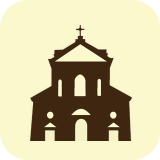

<div align="center">



# Paróquia Nossa Senhora do Rosário

**Site oficial · Jaguaribe, João Pessoa (PB)**

_Horários de missa, liturgia do dia, agenda, pastorais e as colunas da nossa comunidade._

<br />


[Sobre](#sobre) ·
[Princípios](#princípios) ·
[Stack](#stack) ·
[Como rodar](#como-rodar) ·
[Design system](#design-system) ·
[Conteúdo](#conteúdo-e-privacidade) ·
[Roadmap](#roadmap) ·
[Contribuindo](#contribuindo)

</div>

---

## Sobre

A **Paróquia Nossa Senhora do Rosário** fica na Rua Frei Martinho, s/n, em Jaguaribe, João Pessoa. A igreja, neoclássica, foi construída pelos frades franciscanos entre 1927 e 1929, a partir da "campanha do centavo" de Frei Martinho.

Este repositório guarda o site da paróquia. Quem visita é a comunidade do bairro: muita gente idosa, jovens do EJC, famílias. A maioria chega pelo Instagram [@paroquiadorosariojp](https://www.instagram.com/paroquiadorosariojp/) ou por um link no WhatsApp, **no celular**, procurando um horário. Tudo é pensado a partir daí.

| Seção            | O que tem                                                       |
| ---------------- | --------------------------------------------------------------- |
| **Início**       | Próxima missa, avisos, Evangelho de hoje, eventos e últimas colunas |
| **Horários**     | Missas, confissões, adoração e secretaria                        |
| **Liturgia**     | Leituras do dia, santo do dia e a missa de hoje                  |
| **Agenda**       | Festa da padroeira, Semana Santa, Perdão de Assis, juventude     |
| **Pastorais**    | EJC, catequese, cestas básicas e outros movimentos               |
| **Blog**         | Colunas do pároco e da juventude, em texto ou vídeo              |
| **Sacramentos**  | Requisitos, documentos e cursos                                  |
| **Contato**      | Endereço, mapa e atendimento da secretaria                       |
| **Contribua**    | Dízimo e doações por Pix, com a chave para copiar                |

## Princípios

1. **O horário primeiro.** Ninguém precisa abrir um menu para saber a que horas é a missa de domingo.
2. **Legível para todas as idades.** Texto de no mínimo 16px no celular, contraste AA, alvos de toque de 44px e foco de teclado sempre visível.
3. **Celular primeiro.** Desenhado para 360px e ampliado a partir daí, com páginas estáticas que abrem rápido em conexões ruins.
4. **Delicado, nunca duro.** Fundo creme de folheto, texto em marrom suave, sem degradês, sem sombras pesadas e sem emoji na interface.
5. **Privacidade.** Nenhum dado pessoal de fiéis no painel de conteúdo; inscrições vão para formulários próprios. Vídeo do YouTube só carrega (e só rastreia) quando a pessoa clica.
6. **Respeito ao texto litúrgico.** As leituras (tradução da CNBB) só aparecem por inteiro com autorização; por padrão o site mostra a referência e o link para a liturgia oficial.

## Stack

| Camada          | Tecnologia                                                                           |
| --------------- | ------------------------------------------------------------------------------------ |
| Site            | [Astro](https://astro.build) com saída estática; [Vue](https://vuejs.org) só nas partes interativas |
| Linguagem       | TypeScript em todo o projeto                                                         |
| Conteúdo        | [Sanity](https://www.sanity.io) (plano gratuito), com o Studio em português          |
| Hospedagem      | [Cloudflare Pages](https://pages.cloudflare.com) (estático)                          |
| Automação       | GitHub Actions: rebuild diário (liturgia) e backup mensal do conteúdo                |
| Pacotes         | npm workspaces (`site/` e `studio/`)                                                 |

## Estrutura

```text
.
├── design-system/        Fonte da verdade visual: tokens, componentes em CSS e logos
├── scripts/              Sincroniza o design system com o site
├── site/                 Aplicação Astro
│   └── src/
│       ├── components/   Componentes .astro (e .vue quando há interação)
│       ├── layouts/      BaseLayout e PaginaLayout
│       ├── lib/          Datas, horários, YouTube e dados da paróquia
│       ├── pages/        Rotas do site (e /styleguide, só em desenvolvimento)
│       ├── styleguide/   Exemplos e molduras do /styleguide (só desenvolvimento)
│       └── styles/       Cópias geradas de tokens.css e bundle.css, mais global.css
├── studio/               Sanity Studio (schemas em studio/schemas)
└── docs/                 Imagens e documentação
```

## Como rodar

**Pré-requisitos:** Node.js 22.12 ou mais recente e npm.

```bash
npm install                  # na raiz: instala site/ e studio/
npm run dev -w site          # site em http://localhost:4321
npm run dev -w studio        # Studio em http://localhost:3333
```

O `/styleguide` (http://localhost:4321/styleguide) mostra todos os componentes. Ele só existe em desenvolvimento e não entra no site publicado.

| Comando                              | Para quê                                    |
| ------------------------------------ | ------------------------------------------- |
| `npm run build -w site`              | Gera o site estático em `site/dist`         |
| `npm run check -w site`              | Verifica tipos (`astro check`)              |
| `npm run test -w site`               | Roda os testes das funções auxiliares e das consultas GROQ |
| `npm run test -w studio`             | Testa as validações dos schemas e o seed    |
| `npm run seed:gerar -w studio`       | Gera o conteúdo de exemplo para importar    |
| `npm run lint`                       | ESLint                                      |
| `npm run format` / `format:check`    | Prettier                                    |
| `npm run sync:design`                | Copia o design system para o site           |

### Variáveis de ambiente

Copie os exemplos e preencha. Os arquivos `.env` nunca vão para o repositório.

```bash
cp site/.env.example site/.env       # ID/dataset do Sanity e flag da liturgia
cp studio/.env.example studio/.env   # ID/dataset usados pelo Studio
```

### Sanity Studio e conteúdo

Os tipos de conteúdo ficam em [`studio/schemas`](studio/schemas) e o menu lateral do Studio, em português, é organizado em **Início · Agenda · Comunidade · Blog · Liturgia · Configurações** (`studio/estrutura.ts`). No site, `site/src/lib/sanity.ts` traz o cliente e uma consulta GROQ tipada para cada necessidade das páginas.

Para ligar tudo a um projeto do Sanity (uma vez só):

```bash
# 1. Crie o projeto em https://www.sanity.io/manage (plano Free, dataset "production")
#    e preencha o ID em site/.env (PUBLIC_SANITY_PROJECT_ID) e studio/.env (SANITY_STUDIO_PROJECT_ID).
cd studio
npx sanity login
npm run seed:gerar                                                        # gera seed/exemplos.ndjson
npx sanity dataset import seed/exemplos.ndjson production --missing       # importa o conteúdo [EXEMPLO]
npx sanity cors add http://localhost:4321 --credentials                   # site local
npx sanity cors add http://localhost:3333 --credentials                   # Studio local
npx sanity deploy                                                         # publica em <nome>.sanity.studio
```

`--missing` pula o que já existe, então rodar o import de novo não sobrescreve nada. Depois de publicar o site com o domínio final, adicione-o também com `sanity cors add`. Tudo que o seed cria leva `[EXEMPLO]` no texto e deve ser trocado pelo conteúdo real (Fase 9).

**Quem pode publicar:** o plano Free do Sanity só tem os papéis **Administrator** e **Viewer** (Editor e Contributor são do plano Growth). Como todo Administrator pode publicar, a revisão dos posts é feita pelo campo **Status de revisão** (_Rascunho_, _Em revisão_, _Aprovado_): quem escreve deixa em rascunho ou em revisão, e o site só publica posts **Aprovados**. No Studio, _Blog_ tem listas separadas por status para a pessoa que aprova.

## Design system

O visual vem do design system **Igreja do Rosário**, em [`design-system/`](design-system/). Ele nasce do que a paróquia já mostra no Instagram: o logo da fachada em marrom e creme, títulos em serifa com par romano e itálico, o azul mariano das festas de Nossa Senhora, o ouro do altar e a terracota do hábito franciscano.


- **Tokens, não valores soltos.** Cores, espaços e raios vêm de `design-system/tokens.css` (`var(--texto)`, `var(--espaco-4)`…).
- **Componentes com prefixo `ros-`** em `design-system/components/bundle.css`. Cada pasta tem um `preview.html` de referência e um `README.md` com as regras de uso.
- **Fontes:** Playfair Display nos títulos e Nunito Sans no resto, pelo Google Fonts.
- **Destaques delicados:** fundo suave com texto colorido por cima. Cor cheia e escura só no logo e no botão principal.
- **Dois motivos recorrentes:** o _arco_ das janelas da fachada (molduras e bloco de data) e as _contas do terço_ (divisor de seções).

> O design system é a fonte da verdade. Os arquivos em `site/src/styles/` são cópias geradas por `npm run sync:design`: altere o design system, não a cópia.

> Os guias, os comentários e os rótulos do design system estão em inglês. Nomes de tokens, classes `ros-*` e pastas de componentes continuam em português, porque o site depende deles. Os textos de exemplo dos previews seguem em português.

### Componentes

| Componente                        | Componente                      |
| --------------------------------- | ------------------------------- |
| `Header` + `MenuGaveta`           | `LiturgiaDoDia` + `TamanhoTexto` |
| `Hero`                            | `LiturgiaResumo`                 |
| `Botao`                           | `SantoDoDia`                     |
| `CardHorarios`                    | `CardPost`                       |
| `CardEvento`                      | `VideoYouTube`                   |
| `CardPastoral`                    | `DoacaoPix` + `CopiarChave`      |
| `Aviso`                           | `Footer` e `BarraMobile`         |
| `SeloLiturgico` e `DivisorTerco`  | `Icone`                          |

## Conteúdo e privacidade

O conteúdo editável (horários, avisos, eventos, pastorais, blog, santo do dia) fica no **Sanity**, que a equipe da paróquia usa sem mexer em código. O site é reconstruído quando algo é publicado e todo dia de madrugada, para atualizar a liturgia.

Algumas regras importantes:

- O dataset do plano gratuito do Sanity é **público**: nunca guarde ali telefones, e-mails ou inscrições de fiéis.
- Segredos ficam só em variáveis de ambiente.
- Não use imagens de santos baixadas da internet; o santo do dia é só texto.
- Horários seguem o formato da paróquia: **7h**, **17h**, **8h40**. Datas: "17 de novembro".

## Roadmap

| Fase | Entrega                                                | Situação      |
| ---- | ------------------------------------------------------ | ------------- |
| 1    | Estrutura: Astro, Vue, Sanity Studio e design system   | Concluída     |
| 2    | Componentes do design system em Astro                  | Concluída     |
| 3    | Modelo de conteúdo no Sanity                           | Concluída     |
| 4    | Páginas lendo do Sanity                                | Concluída     |
| 5    | Liturgia e santo do dia automáticos                    | Concluída     |
| 6    | Qualidade: SEO, acessibilidade e desempenho            | Concluída     |
| 7    | Reajustes de layout                                    | Concluída     |
| 8    | Publicação e automações                                | Em andamento  |
| 9    | Conteúdo real e equipe                                 | A fazer       |
| 10   | Lançamento                                             | A fazer       |

A Fase 8 já tem os workflows do GitHub Actions (rebuild diário e backup mensal) e o passo a passo dos painéis do Cloudflare, do Sanity e do Registro.br em [`docs/deploy.md`](docs/deploy.md).

Antes do lançamento ainda faltam informações da paróquia (horários 2026/2027, chave Pix e titular, contatos, lista de pastorais, requisitos dos sacramentos, texto da história e fotos). Enquanto isso, o código usa marcadores `TODO(paroquia)`.

## Contribuindo

- Trabalhe em uma branch própria (`feat/…`, `fix/…`, `docs/…`); a `main` é protegida.
- Mensagens de commit no padrão [Conventional Commits](https://www.conventionalcommits.org), em inglês: `feat: add parish schedule card`.
- Antes de abrir um pull request, rode `npm run check -w site`, `npm run lint` e `npm run build -w site`.
- Mudanças visuais seguem o design system: sem cores, espaços ou raios em valor cru.

## Licença

A licença do código ainda será definida pela paróquia. O nome, o logo e as fotos pertencem à Paróquia Nossa Senhora do Rosário.

<div align="center">

<br />

_Nossa Senhora do Rosário, rogai por nós._

</div>
